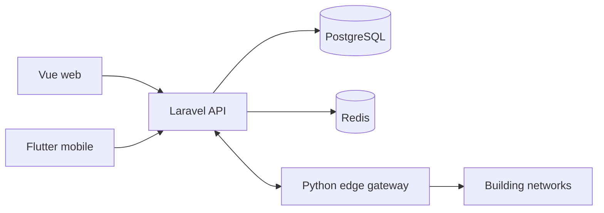

# Architecture

## System context

Cloud API owns tenant identity, authorization, inventory, telemetry storage, alarms and command policy. Edge gateway owns protocol connections, local buffering and final safety checks. Clients never access building networks directly. A future broker carries mutually authenticated MQTT messages; WebSockets deliver live updates to clients. M1 has only a status API and inert edge process.

## Data and command paths

Telemetry path: adapter reads point, normalizes value/unit/quality/timestamp, assigns monotonic source sequence, persists to local buffer, publishes securely, API validates tenant/device mapping and deduplicates, stores history, then fans out updates. Commands require an authenticated user, tenant and role check, point allowlist, value bounds, optional approval, expiry and idempotency key. The edge rechecks all restrictions before any protocol write, then reports acknowledgement and observed state. Physical writes remain disabled by default.

## Deployment

Local Compose is development only. Production topology separates the public API from database and Redis; uses TLS, secret management, database backups and restore drills, broker authentication, edge certificate provisioning, observability, and phased rollout. Edge gateways have outbound-only cloud connectivity where practical. Offline buffering has bounded disk usage and explicit overflow alerts.

## Repository boundaries

`apps/api` contains API and relational migrations; `apps/web` and `apps/mobile` consume versioned contracts; `services/edge-agent` contains protocol boundary; `packages/contracts` holds public schemas; `infra` holds development images and future deployment assets; `tests` holds cross-component fixtures and scenarios.

## Mobile foundation

The authenticated organization discovery route joins active memberships to organizations and current role permissions in one tenant-bound query. It supplies only the caller's organization IDs, names, roles, and permission codes for future mobile selection. Server authorization remains authoritative for every scoped request.

The Flutter app has Android and iOS runners and a modular shell. Riverpod manages session state and in-process locale/theme preferences; GoRouter guards startup, login, organization selection, and dashboard routes. A public Dio client calls status and login, while a protected client attaches the Sanctum bearer token only to authenticated routes. Secure storage holds the token, expiry, and selected organization ID. Startup validates a stored token with `/auth/me` before opening protected navigation, then refreshes organization discovery. Session generations and request cancellation discard late responses after logout or organization changes. The selected organization is UI context, never proof of authorization; Laravel must authorize every future tenant-scoped query. No building data fetch or equipment command is active. See `FLUTTER_ARCHITECTURE.md`.
